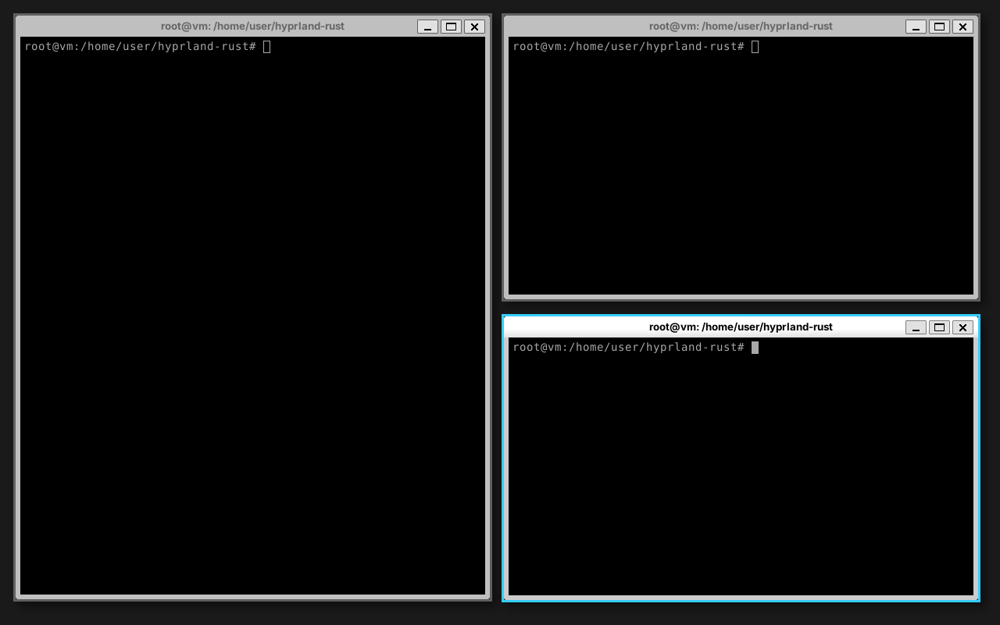

# hyprland-rust

An original reimplementation of [Hyprland](https://hyprland.org) (the dynamic
tiling Wayland compositor) in Rust, built on
[Smithay](https://github.com/Smithay/smithay). It aims at compatibility with
Hyprland's `hyprland.conf` syntax, dispatchers and `hyprctl` IPC. It is not a
line-by-line port and is not affiliated with the Hyprland project.



## Status

Usable for testing, not yet proven on real hardware. CI runs the TTY backend on
the kernel's virtual KMS device (VKMS) with seatd, but it has **not been run on
a real GPU**.

What works now (targeting Hyprland v0.57.1 behaviour):

- Backends: `winit` (nested window), `tty` (DRM/KMS + libinput + libseat; one
  output per connector, udev hotplug, xcursor cursor; `AQ_DRM_DEVICES` picks the
  GPU), `headless` (virtual outputs without rendering, for CI).
- Multiple monitors: per-monitor workspaces, `monitor =` rules, monitor
  dispatchers, `hyprctl output create/remove`.
- Layouts: dwindle and master (per workspace, `layoutmsg`), groups, floating,
  fullscreen, pinned windows, dynamic, named and special workspaces.
- Visual effects: rounded corners, gradient borders, shadows, blur, opacity and
  dim, Bézier animations.
- XWayland: managed and override-redirect windows, clipboard bridge.
- Touchpad gestures (`gesture =`), pointer-gestures for clients.
- Config in either format: `hyprland.lua` (Hyprland >= 0.55 Lua API, including
  function binds, `hl.on`, `hl.timer`, `hl.get_*`) or `hyprland.conf` (hyprlang:
  variables, `source` globs, `bind` flags, submaps, `device { }`, window and
  layer rules, `env`). Autoreload on file change.
- Popular dotfiles load with zero config errors in CI: end-4, ML4W, HyDE,
  JaKooLit and Hyprland's own example.
- Protocols used by desktop tools: wlr-layer-shell, screencopy (shm),
  ext-image-copy-capture, foreign-toplevel, linux-dmabuf, gamma control,
  session lock, idle, input method, and Hyprland's focus-grab, toplevel-export,
  toplevel-mapping, ctm-control and global-shortcuts. The full table is
  [`docs/PARITY.md`](docs/PARITY.md).
- IPC: Hyprland-style request and event sockets and a `hyprctl` binary.

Not done yet: running on real hardware, fractional scale, on-screen
notifications, plugins, HDR/VRR. See [`docs/ROADMAP.md`](docs/ROADMAP.md) (in
Turkish) and [`docs/MIGRATION.md`](docs/MIGRATION.md) for moving from Hyprland.

## Building

Debian/Ubuntu packages:

```sh
sudo apt install libwayland-dev libxkbcommon-dev libudev-dev libinput-dev \
  libseat-dev libgbm-dev libegl-dev libdrm-dev libgles-dev pkg-config
cargo build
```

This produces `hyprland-rust` and `hyprctl` in `target/debug/`.

## Usage

```sh
hyprland-rust [-c FILE] [--backend winit|tty|headless] [--check-config]
```

- `-c, --config FILE`: config file (default
  `$XDG_CONFIG_HOME/hypr/hyprland.lua`, then `hyprland.conf`; built-in defaults
  if neither exists).
- `--backend`: default is `winit` if `WAYLAND_DISPLAY` or `DISPLAY` is set,
  otherwise `tty`.
- `--check-config`: parse the config, print the error count and exit.
- `HYPR_HEADLESS_OUTPUTS=N`: number of headless outputs (default 1).
- `HYPR_HEADLESS_SIZE=WxH`: output size for the headless backend (default
  1920x1080).
- `RUST_LOG=debug`: verbose logs.

Nested: run it from inside a desktop session and it opens as a window (the host
may intercept `SUPER` shortcuts). On a TTY: switch to a free VT, log in and run
it with no display variables set (or `--backend tty`).

```sh
hyprland-rust -c examples/hyprland.conf
hyprctl -j clients
hyprctl dispatch workspace 2
```

## Testing

```sh
cargo test
cargo clippy --all-targets -- -D warnings
```

Integration scripts in `tests/` (run from the repository root after
`cargo build`; they need Xvfb, xdotool, weston, waybar, dbus, wl-clipboard and python3 as listed in
`.github/workflows/ci.yml`):

- `tests/keybinds-xvfb.sh`: nested compositor in Xvfb, key presses via xdotool.
- `tests/headless-smoke.sh`: headless backend with two clients, layout checked
  through `hyprctl -j clients`.
- `tests/ipc-xvfb.sh`: `hyprctl` requests and events on the sockets.
- `tests/layer-shell.sh`: waybar exclusive zone and `hyprctl layers`.
- `tests/window-rules.sh`: window rules applied to new windows.
- `tests/master-groups.sh`: master layout, `layoutmsg` and groups.
- `tests/protocols.sh`: clipboard (wl-copy/wl-paste, primary selection).
- `tests/dispatchers.sh`: workspace, cursor and z-order dispatchers.
- `tests/lua-config.sh`: a `hyprland.lua` config and Lua `hyprctl dispatch`.
- `tests/multimon.sh`, `tests/tty-vkms.sh`, `tests/xwayland.sh`, `tests/render-fx.sh`:
  monitors, DRM/KMS on VKMS, X11 clients, effects.
- `tests/dots-conf.sh`, `tests/dots-lua.sh`: popular dotfiles at pinned commits.

GitHub Actions runs all of the above on every push.

## License

BSD-3-Clause, like Hyprland (see `LICENSE`). Parts of the compositor core are
derived from Smithay's `smallvil` and `anvil` examples (MIT); see
`docs/SMITHAY-LICENSE`.
